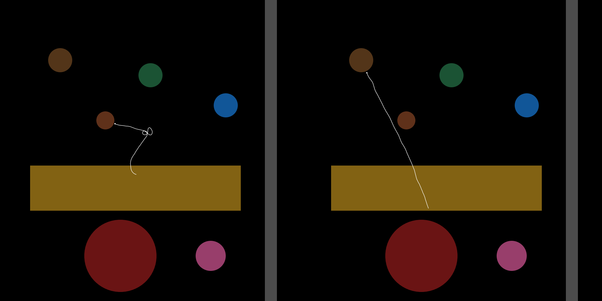

# Phase 3 S8.4 movement examples



Both panels use the same 10×10 km map, black background, coloured zones and white path. The left panel shows low urgency/high boredom with a visible detour; the right shows high urgency/low boredom with a direct route. The endpoint dot marks arrival. No labels, axes, legends, timestamps or other text appear in the PNG.

These are explicitly selected real trips from the seed-42 S8.3 evaluation, not typical averages or a controlled causal comparison. They have different destinations and starting points. They illustrate possible movement styles; **the S8.3 population targets and walking guardrail still fail as documented in [the evaluation](PHASE3_S83_RESULTS.md)**. No settings were tuned for this figure.

| Property | Left: wandering | Right: direct |
| --- | --- | --- |
| Day / trip | 318 / 6 | 254 / 11 |
| Destination | Kopje | Den |
| Simulated departure | 2026-11-15 01:06 | 2026-09-12 00:17 |
| Simulated arrival | 2026-11-15 02:27 | 2026-09-12 01:41 |
| Urgency at start | 0.200 | 0.962 |
| Boredom at start | 0.985 | 0.160 |
| Planned detours | 1 | 0 |
| Observed straightness | 0.474 | 0.996 |
| Observed chord deviation | 1.048 km | 0.117 km |
| Observed mean speed | 2.854 km/h | 3.547 km/h |

The white paths use causal trailing five-minute averages of **observed GPS**, on the same inclusive trip boundaries used by S8.3. Smoothing includes earlier fixes before departure. This is distinct from the ordinary report PNGs below, which preserve their existing raw observed cumulative paths. Day indices refer to independent days starting at 05:00 on 2026-01-01; these two trips occur after midnight on the following calendar date.

[Scalar provenance](style_examples.json) records ISO timestamps, trip metrics, starting bars, planned detours, source manifest SHA-256 and package version. It contains no trajectory coordinates. The figure is 2000×1000 pixels: two unchanged 1000×1000 map renders joined horizontally.

## Usual days 1–3 PNGs

Rendered eight cumulative report paths plus one contact sheet per day, **27 PNGs total**, using package 5.2.0 and seed 42:

- [Day 1 contact sheet](../outputs/phase3_s84_images/run_20261103_212040/days/day_0001/images/2026-01-01_day0001_contact_sheet.png)
- [Day 2 contact sheet](../outputs/phase3_s84_images/run_20261103_212040/days/day_0002/images/2026-01-02_day0002_contact_sheet.png)
- [Day 3 contact sheet](../outputs/phase3_s84_images/run_20261103_212040/days/day_0003/images/2026-01-03_day0003_contact_sheet.png)

Each contact sheet reads left-to-right, then top-to-bottom: 08:00, 11:00, 14:00, 17:00, 20:00, 23:00, next-day 02:00 and 05:00. Times appear in individual report filenames, never inside the images. Report PNGs are 1000×1000; contact sheets are 2000×4000. The run is in the ignored outputs directory, with its manifest and resumable checkpoints. No per-minute files were saved.

All three days' target rows and scalar statistics exactly match the same days of S8.3. The small run's incidental statistics are not a new calibration experiment.

## Reproduce

Run from the repository root with the original 5.2.0 environment and source checkpoints:

```sh
python -m lionsim.style_examples outputs/phase3_s83_stats/run_20261103_141337 --wandering 318 6 --direct 254 11 --out docs/style_examples.png
python -m lionsim.run --stats-only --stats-days 3 --seed 42 --image-days 3 --workers 3 --out outputs/phase3_s84_images
```

The example tool validates the source package/schema version and regenerated trip metrics against saved checkpoints before publishing. Selection is explicit, not silently searched or changed. It reuses the existing normal renderer without modifying its appearance. Existing image and smoothing settings are taken from the source manifest; no new defaults or checkpoint contracts were introduced.

## Verification

Six targeted example/plotting tests passed. The comparison and all three contact sheets were visually inspected. All 28 PNGs decoded successfully; each contact-sheet tile exactly matched its report PNG, all checkpoint file sizes matched, and the run completed all three days with passing event invariants. Full suite: **233 passed in 53.90s**. All prior simulation defaults and simulator/style/features/events/reports/plotting modules are unchanged from S8.3.
